<p align="center">
  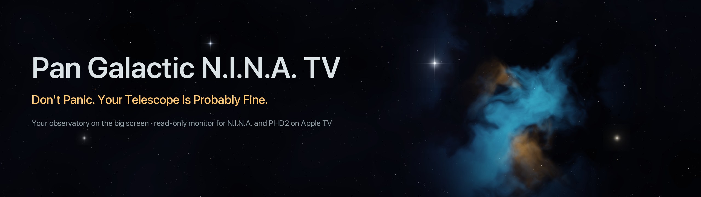
</p>

<p align="center">
  <a href="https://github.com/lindekai/PanGalacticNinaTV/actions/workflows/ci.yml"></a>
  
  
  
  
  
  <a href="LICENSE"></a>
</p>

<p align="center">
  <b>Your observatory on the big screen.</b><br>
  A native Apple TV app that shows what N.I.N.A. is doing – readable from the couch, and unable to touch your telescope.
</p>

<p align="center">
  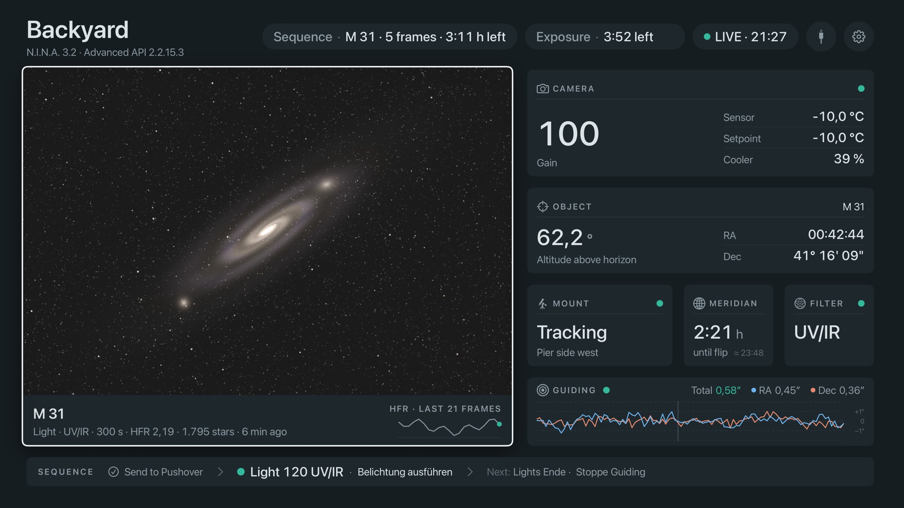
</p>

<p align="center"><sub>Every screenshot comes from the tvOS Simulator running against the bundled <a href="#try-it-without-a-telescope">demo server</a>: a procedural galaxy and sanitized test data, no real observatory.</sub></p>

---

## Why

Imaging nights are long. The telescope PC sits outside or in a corner, and you want to know – at a glance and from across the room – whether the sequence is still running, the camera is cold and the last frame looks right. **Pan Galactic N.I.N.A. TV** puts exactly that on your TV, and nothing more.

## What it does today

### The overview

One screen for the whole night, laid out for a TV across the room.

- **Newest frame** as soon as N.I.N.A. saves it, with target, filter, exposure, HFR, star count, age and an **HFR trend** of the last frames.
- **Header pills:** the running **sequence** with target, frames and the time left in a time-bound loop, the **exposure countdown**, and the connection state – **LIVE**, **Stale** with the time of the last data, or **Offline**.
- **Camera:** sensor temperature, the setpoint while the cooler runs, cooler power and gain.
- **Object:** altitude above the horizon and coordinates.
- **Mount, meridian and filter** as compact tiles: tracking state and pier side, the **time to the meridian flip** with its approximate clock time, and the active filter.
- **Guiding chart:** RA and Dec of the last guide steps with dither markers, and the **total RMS** in arcseconds coloured like a traffic light – green below 1″, yellow up to 2″, red above. The light turns red when the guide star is lost.
- **Sequence strip:** the last step (✓, or ✕ if it failed), the current step with its container, and the next step. A click opens the sequence page.
- **Focus starts on the image**, so one click opens it.

### The sequence

<p align="center">
  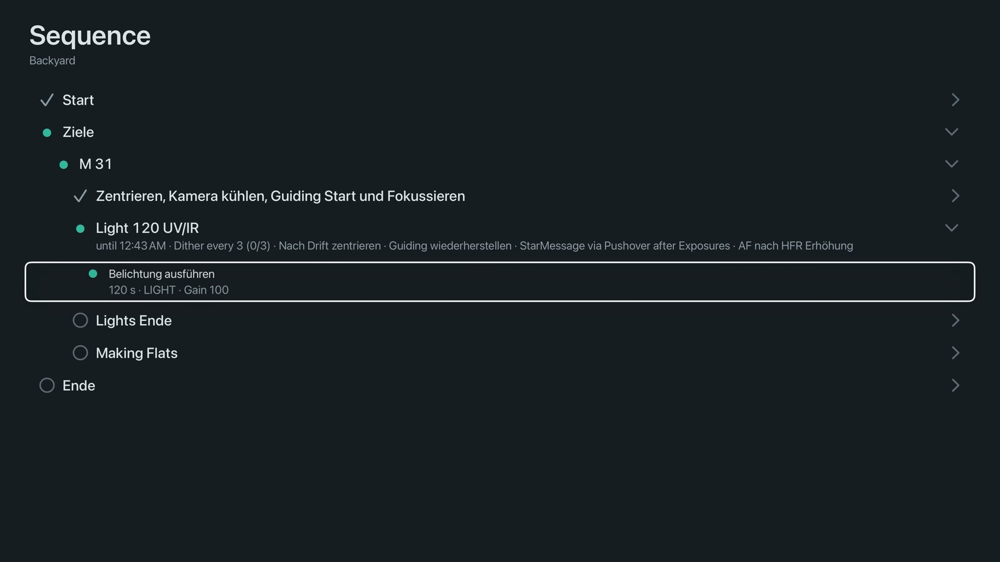
</p>

The whole Advanced Sequence as a tree, with a status per step. The running branch is expanded and the page opens on the current step; containers expand and collapse with a click. Under each step you see what N.I.N.A. reports: loop end and iterations, the dither interval, exposure time, type, gain, filter and temperature. Step names are shown exactly as N.I.N.A. sends them (the German names in the screenshot come from a German N.I.N.A.). The page is read-only.

### Full-screen viewer with stepped zoom

<table>
  <tr>
    <td width="50%">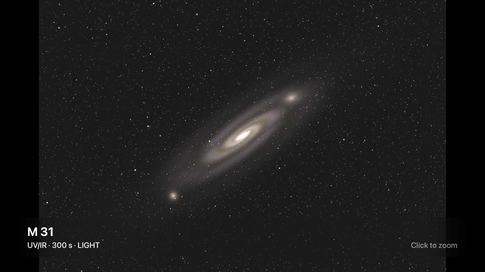</td>
    <td width="50%">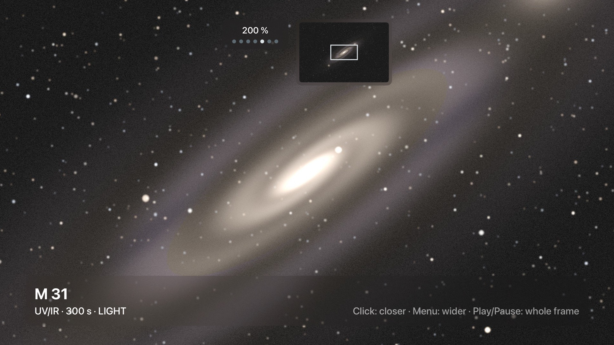</td>
  </tr>
  <tr>
    <td>The whole frame, rendered by N.I.N.A. at 1920 px.</td>
    <td>200 %: the step indicator and the overview map fade in for two seconds after every change.</td>
  </tr>
</table>

- **Click** zooms one step closer: whole frame, then 75 %, 100 % (1:1), 150 %, 200 %, 300 % and 400 % on a 4K TV. An HD TV also gets a 50 % step.
- **Menu** steps back out, and **Play/Pause** jumps straight to the whole frame.
- **Swipe** to drag the picture continuously, or **click the touch surface's edges** to move a quarter screen.
- From 100 % on, sensor pixels are drawn as crisp squares, so star shapes can be judged instead of being smoothed away.
- The full-resolution frame is rendered **once**, on the first zoom. The viewer never polls it.

### Ambient mode

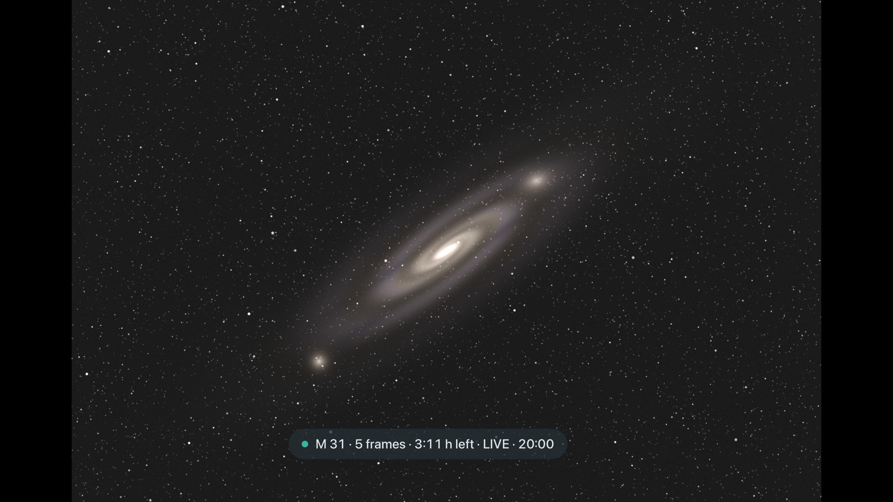

- After a few minutes without input, the newest frame fills the screen with a **slim glass strip** showing target, sequence progress, connection state and time.
- New frames **cross-fade** in.
- The strip **wanders** a little every few minutes, so nothing burns into an OLED panel.
- **Any button** brings the overview back.
- An **alarm** ends ambient mode at once, and it never starts while one is active. Alarms are a lost connection or an exposure that is overdue.
- While ambient mode is enabled, the **tvOS screensaver stays off** on the overview.
- **Settings:** on or off, and the delay from 1 to 30 minutes (default 5).

### Devices and their details

<table>
  <tr>
    <td width="50%">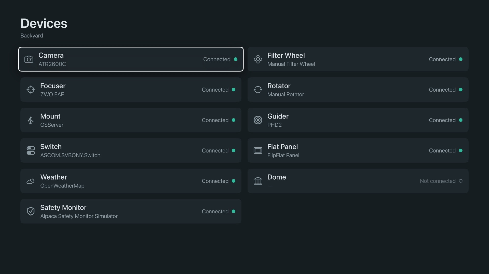</td>
    <td width="50%">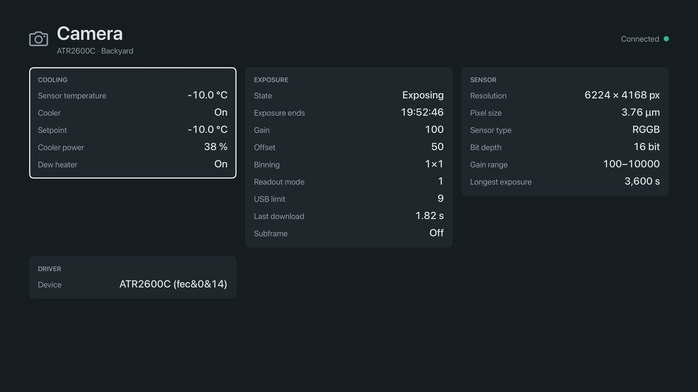</td>
  </tr>
  <tr>
    <td width="50%">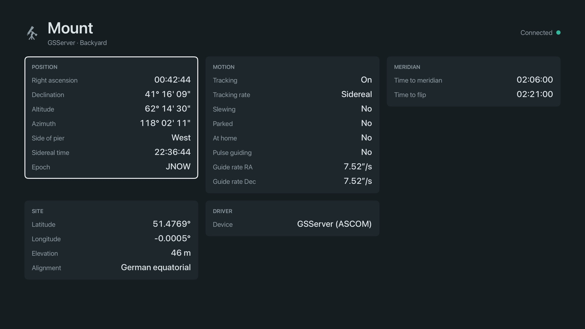</td>
    <td width="50%">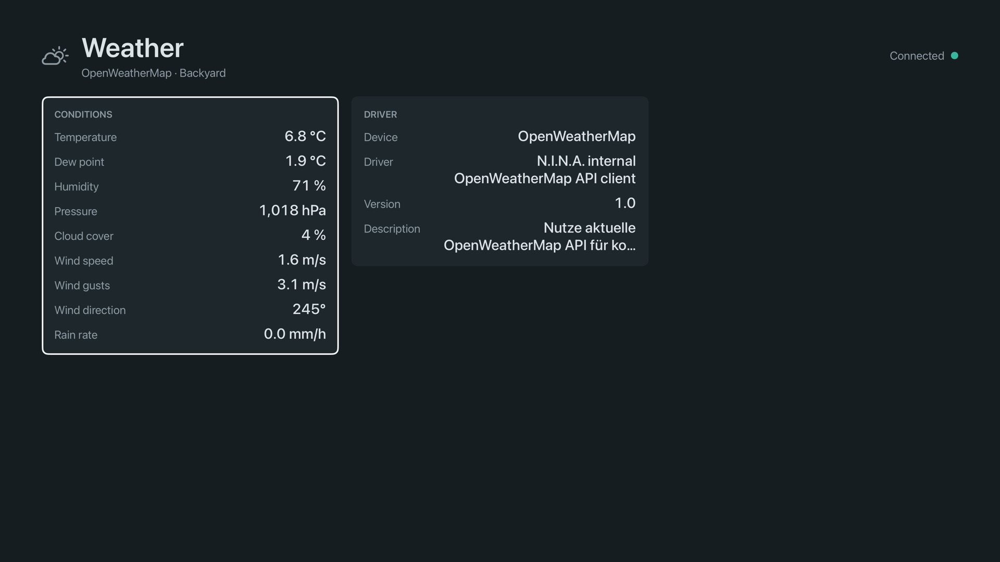</td>
  </tr>
</table>

- **All eleven device types** N.I.N.A. knows, each with its name and *Connected*, *Not connected* or *Unknown*: camera, filter wheel, focuser, rotator, mount, guider, switch, flat panel, weather, dome and safety monitor.
- **One click opens a device's details:** everything N.I.N.A. reports about it, in groups.
  - **Camera:** cooling, exposure and sensor.
  - **Mount:** position, motion, meridian flip and site, including the coordinates – handy when you watch more than one observatory.
  - **Switch:** readings and outputs.
  - **Filter wheel:** every filter, with the active one highlighted.
  - **Weather:** conditions and sky quality.
  - **Safety monitor:** a clear *Unsafe*, shown only while the device is connected.
- **Honest values.** A device that is not connected shows no numbers at all. N.I.N.A. fills such objects with defaults like 0 °C or "pier east", and those would only mislead. A missing reading shows as *—*, never as 0.
- **No new requests.** The details come from the same `/equipment/info` poll as the overview.

### Also on board

- **Several N.I.N.A. instances**, found by a network scan or entered by hand. The app reconnects automatically with backoff, and a stale state is clearly marked.
- **German and English** throughout, following the Apple TV's language.
- **A Top Shelf banner and a layered app icon** with parallax on the Home Screen.

## Safety first

> [!IMPORTANT]
> **The app is monitoring-only.** It never parks, slews, captures, starts or stops anything.
>
> The N.I.N.A. Advanced API exposes control actions as plain HTTP `GET` routes and has no authentication, so "only use GET" is not a safety guarantee. The app therefore uses an **explicit allowlist** of source-reviewed, side-effect-free endpoints, enforced twice in code and covered by tests. It never sends commands to the PHD2 socket. Details: [ADR 0001](docs/adr/0001-read-only-endpoint-allowlist.md) · [API capability matrix](docs/api-capability-matrix.md).

Other ground rules:
- **No invented data.** Values are *measured*, *derived*, *estimated* or *unavailable*.
- **Nothing hardcoded.** No network addresses and no hardware are built in.
- **Nothing to install** on the telescope PC.
- **Reviewed against the source.** Every field the app interprets is checked against the plugin and N.I.N.A. source at a pinned revision before it is shown.

## How it works

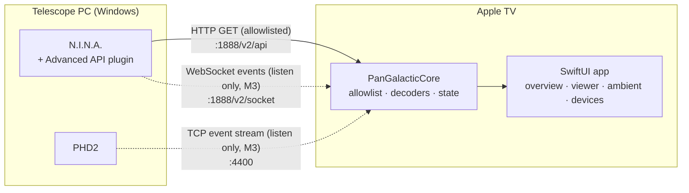

**One poll every 5 seconds.** `/equipment/info` and the image-history count are fetched each cycle. Image metadata and the thumbnail are fetched only when a new frame arrives, and the sequence state at most every 15 seconds. Full-resolution renders happen only when you ask for them, and only one request is in flight at a time. Dashed lines are planned for M3.

## Try it without a telescope

`tools/demo/demo_server.py` is a pretend N.I.N.A. on `127.0.0.1`. It answers the app's read-only routes from the sanitized test fixtures, dressed up as a clear night:
- the camera is cooled and exposing;
- the mount is tracking M 31 and guiding is running, with a live guide graph (`--guider-state LostLock` shows a lost star);
- a time-bound sequence loop has a few hours left;
- a history of frames shows a procedural galaxy.

```sh
python3 -m pip install Pillow numpy
python3 tools/demo/demo_server.py      # → http://127.0.0.1:1888/v2/api
```

Then add an instance with host `127.0.0.1` in the app. The tvOS Simulator shares the Mac's network. The screenshots above were taken this way.

## Roadmap

| | Milestone | Status |
|---|---|---|
| **M0** | API feasibility – pinned sources, capability matrix, allowlist, live read-only fixtures | ✅ Complete – [report](docs/m0-report.md) |
| **M1** | Xcode project, instances, discovery, reconnect | ✅ Done |
| **M2** | Overview and imaging – dashboard, viewer with zoom, ambient mode, devices, sequence progress, TestFlight | ✅ Done – in beta on TestFlight |
| **M3** | Guiding and alerts – PHD2 chart, RMS, WebSocket events, foreground alarms | 🟡 Part 1 done; part 2 waits for a clear night |
| **M4** | Astronomy views – sky compass, altitude curve, Sun/Moon, star map | 🟡 Next |
| **M5** | Conditions, statistics, personality | ⚪ Planned |
| **M6** | Reliability, field test, release readiness | ⚪ Planned |

Details in [docs/milestones.md](docs/milestones.md) and on the [GitHub milestones](https://github.com/lindekai/PanGalacticNinaTV/milestones) page.

## Requirements

- Apple TV HD or newer with tvOS 26 or later
- [N.I.N.A.](https://nighttime-imaging.eu/) with the [Advanced API](https://github.com/christian-photo/ninaAPI) plugin (developed against 2.2.15.3), reachable on the local network
- [PHD2](https://openphdguiding.org/) with its server enabled – optional, for live guiding data from M3 on

## Repository layout

```text
App/                       tvOS app (SwiftUI): overview, viewer, ambient mode, devices, settings
Packages/PanGalacticCore   Swift package: PanGalacticCore (allowlist, decoding, zoom, device details, PHD2)
                           and PanGalacticServices (HTTP, connection, store, discovery)
tools/demo                 Demo N.I.N.A. server for screenshots and UI work (Python)
tools/icons                Generator for the procedural app icon and Top Shelf images (Python)
tools/m0                   Read-only capture tooling for API verification (Python, stdlib only)
docs/                      Architecture, ADRs, capability matrix, milestones, procedures
```

## Development

```sh
# Core and services packages
cd Packages/PanGalacticCore && swift test

# tvOS app (open PanGalacticNinaTV.xcodeproj in Xcode 26+, or:)
xcodebuild -project PanGalacticNinaTV.xcodeproj -scheme PanGalacticNinaTV \
  -destination 'generic/platform=tvOS' CODE_SIGNING_ALLOWED=NO build

# M0 capture tooling self-tests
python3 tools/m0/tests/test_m0probe.py
```

Signing, TestFlight and simulator tips are in [docs/status.md](docs/status.md). See [CONTRIBUTING.md](CONTRIBUTING.md) and the [contributor guidelines](AGENTS.md) before opening a pull request.

## Documentation

- [Project status](docs/status.md)
- [Architecture](docs/architecture.md)
- [API capability matrix](docs/api-capability-matrix.md) – every endpoint and field, with source references
- [Decisions (ADRs)](docs/adr/)
- [Milestones](docs/milestones.md)
- [M0 report](docs/m0-report.md) · [M0 live test procedure](docs/m0-test-procedure.md)
- [Changelog](CHANGELOG.md)
- [Security policy](SECURITY.md)

## Artwork

<p>
  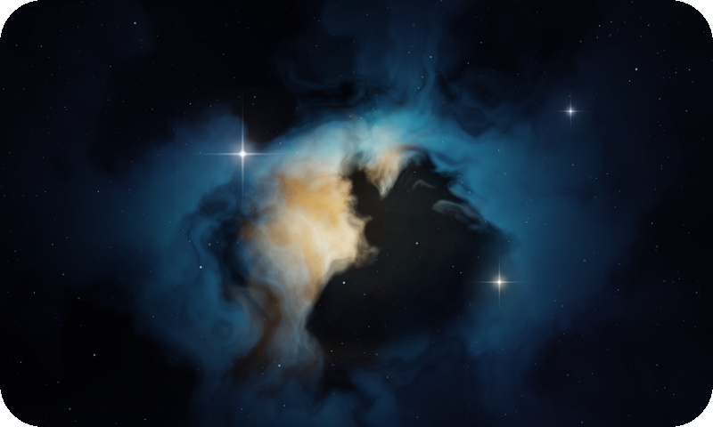
  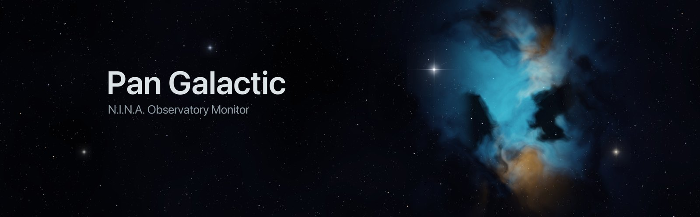
</p>

The app icon (three parallax layers) and the Top Shelf banner are drawn procedurally by [`tools/icons/make_placeholder_icons.py`](tools/icons/make_placeholder_icons.py); the banner at the top of this page uses the same nebula ([`tools/icons/make_banner.py`](tools/icons/make_banner.py)). The demo galaxy in the screenshots comes from [`tools/demo/demo_server.py`](tools/demo/demo_server.py). Both are seeded, so they look the same on every run.

## Credits

- **Author:** Kai Linde – [github.com/lindekai](https://github.com/lindekai)
- **Community:** Dark Matters Discord

Built on the shoulders of the [N.I.N.A.](https://nighttime-imaging.eu/) project, Christian Palm's [Advanced API plugin](https://github.com/christian-photo/ninaAPI) and the [PHD2](https://openphdguiding.org/) team. Thank you.

## Disclaimer

Independent, unofficial companion app. Not affiliated with or endorsed by the N.I.N.A. project, the Advanced API plugin author or the PHD2 project. Apple TV and tvOS are trademarks of Apple Inc.

## License

[MIT](LICENSE). Third-party catalogs and data used later (star catalogs, ephemerides) keep their own licenses; see `docs/licensing-and-attribution.md` once added.
