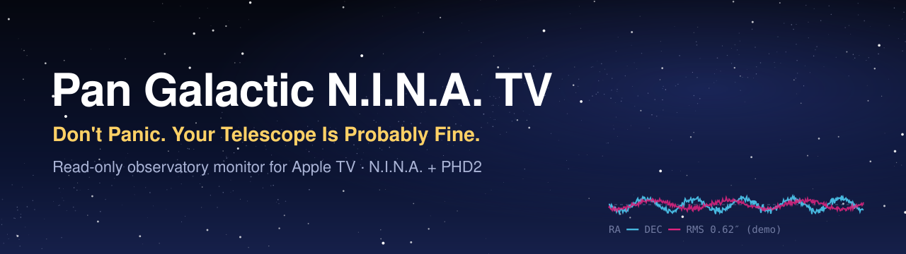
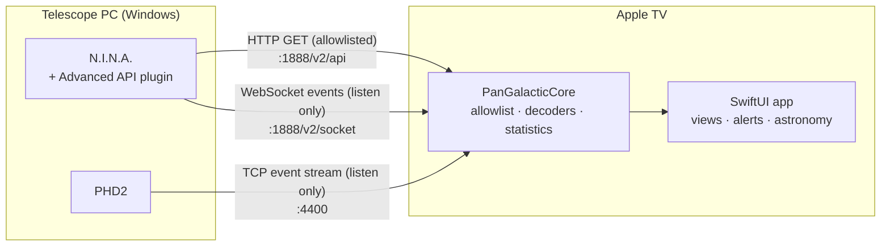

<p align="center">
  
</p>

<p align="center">
  <a href="https://github.com/lindekai/PanGalacticNinaTV/actions/workflows/ci.yml"></a>
  
  
  
  
  <a href="LICENSE"></a>
</p>

<p align="center">
  <b>Your observatory on the big screen.</b><br>
  A native Apple TV app that shows what N.I.N.A. and PHD2 are doing – readable from the couch, and unable to touch your telescope.
</p>

---

## Why

Imaging nights are long. The telescope PC sits outside or in a corner, and you want to know – at a glance and from across the room – whether the sequence is still running, the guiding is calm and the last frame looks right. **Pan Galactic N.I.N.A. TV** puts exactly that on your TV, and nothing more.

## Planned features

| View | What you see |
|---|---|
| **Overview** | Latest frame, target, sequence progress, camera temperature and cooler, filter, mount status, compact guide graph, alarms |
| **Imaging** | Large stretched preview, capture metadata, HFR/stars where available, full-screen viewer with zoom and pan |
| **Guiding** | Live RA/Dec error chart from PHD2, RMS in arcseconds when the image scale is known, dither/settle/star-lost markers |
| **Astronomy** | Sky compass, altitude curve, Sun/Moon/planets, twilight, offline star map with target and camera field of view, time travel |
| **Conditions** | Weather forecast and local sensor readings, always labelled by source and age |
| **Statistics** | Integration per filter, quality and guiding trends – only metrics that are actually measured |

Plus: multiple N.I.N.A. instances, automatic reconnect, German and English UI, foreground-only alarms, and an optional, strictly non-diagnostic sense of humour.

## Safety first

> [!IMPORTANT]
> **The app is monitoring-only.** It never parks, slews, captures, starts or stops anything.
>
> The N.I.N.A. Advanced API exposes control actions as plain HTTP `GET` routes and has no authentication, so "only use GET" is not a safety guarantee. The app therefore uses an **explicit allowlist** of source-reviewed, side-effect-free endpoints, enforced twice in code and covered by tests. It never sends commands to the PHD2 socket. Details: [ADR 0001](docs/adr/0001-read-only-endpoint-allowlist.md) · [API capability matrix](docs/api-capability-matrix.md).

Other ground rules: no invented data (values are *measured*, *derived*, *estimated* or *unavailable*), no hardcoded network or hardware, nothing installed on the telescope PC.

## How it works



## Roadmap

| | Milestone | Status |
|---|---|---|
| **M0** | API feasibility – pinned sources, capability matrix, allowlist, live read-only fixtures | ✅ Complete – [report](docs/m0-report.md) |
| **M1** | Xcode project, instances, discovery, reconnect | ✅ Done |
| **M2** | Overview and imaging | 🟡 In progress |
| **M3** | Guiding and alerts | ⚪ Planned |
| **M4** | Astronomy views | ⚪ Planned |
| **M5** | Conditions, statistics, localization, personality | ⚪ Planned |
| **M6** | Reliability, field test, release readiness | ⚪ Planned |

Details in [docs/milestones.md](docs/milestones.md) and on the [GitHub milestones](https://github.com/lindekai/PanGalacticNinaTV/milestones) page.

## Requirements (planned)

- Apple TV HD or newer with tvOS 26 or later
- [N.I.N.A.](https://nighttime-imaging.eu/) with the [Advanced API](https://github.com/christian-photo/ninaAPI) plugin (developed against 2.2.15.3), reachable on the local network
- [PHD2](https://openphdguiding.org/) with its server enabled – optional, for live guiding data

## Repository layout

```text
App/                       tvOS app (SwiftUI): setup, picker, dashboard, settings
Packages/PanGalacticCore   Swift package: PanGalacticCore (allowlist, decoding, PHD2, state) and PanGalacticServices (HTTP, store, discovery)
tools/m0                   Read-only capture tooling for API verification (Python, stdlib only)
docs/                      Architecture, ADRs, capability matrix, milestones, procedures
```

## Development

```sh
# Core and services packages
cd Packages/PanGalacticCore && swift test

# tvOS app (open PanGalacticNinaTV.xcodeproj in Xcode 26+, or:)
xcodebuild -project PanGalacticNinaTV.xcodeproj -scheme PanGalacticNinaTV \
  -destination 'generic/platform=tvOS' CODE_SIGNING_ALLOWED=NO build

# M0 capture tooling self-tests
python3 tools/m0/tests/test_m0probe.py
```

See [CONTRIBUTING.md](CONTRIBUTING.md) and the [contributor guidelines](AGENTS.md) before opening a pull request.

## Documentation

- [Architecture](docs/architecture.md)
- [API capability matrix](docs/api-capability-matrix.md)
- [Decisions (ADRs)](docs/adr/)
- [Milestones](docs/milestones.md)
- [M0 report](docs/m0-report.md)
- [M0 live test procedure](docs/m0-test-procedure.md)
- [Changelog](CHANGELOG.md)
- [Security policy](SECURITY.md)

## Acknowledgements

Built on the shoulders of the [N.I.N.A.](https://nighttime-imaging.eu/) project, Christian Palm's [Advanced API plugin](https://github.com/christian-photo/ninaAPI) and the [PHD2](https://openphdguiding.org/) team. Thank you.

## Disclaimer

Independent, unofficial companion app. Not affiliated with or endorsed by the N.I.N.A. project, the Advanced API plugin author or the PHD2 project. Apple TV and tvOS are trademarks of Apple Inc.

## License

[MIT](LICENSE). Third-party catalogs and data used later (star catalogs, ephemerides) keep their own licenses; see `docs/licensing-and-attribution.md` once added.
